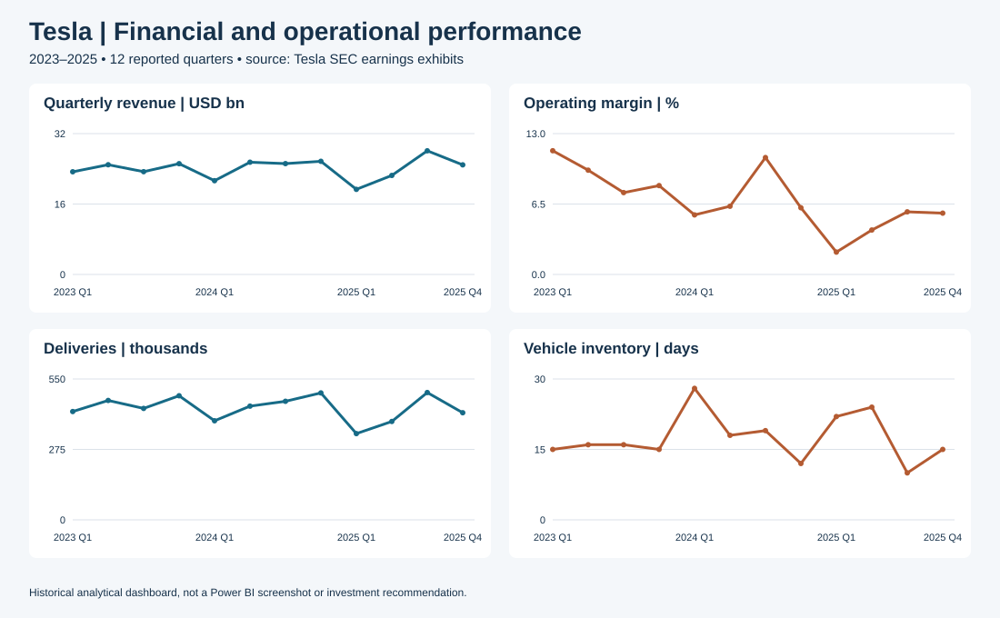

# Tesla Business KPI & Strategic Analysis

## Overview
This project turns the Tesla business-management report into a practical Data Analyst / Business Analyst portfolio project.

The analysis focuses on Tesla's products and services, internal and external environment, PESTLE factors, competitive forces, SWOT findings, COVID-19 business impact, mitigation measures, and strategic recommendations.

## Business Questions
- How do Tesla's business capabilities support competitive advantage?
- Which PESTLE factors create opportunities or risks?
- What are the major strengths, weaknesses, opportunities and threats?
- Which KPIs should management monitor?
- What strategic actions can improve growth and reduce defects?

## Deliverables
- `tesla_kpi_analysis.py` — runnable Python analysis that creates KPI tables and charts.
- No external dataset is required; the script uses clearly labelled values extracted from the supplied report.

## Run
```bash
pip install pandas matplotlib
python tesla_kpi_analysis.py
```

## Important Note
The source report contains historical/academic figures and some values that are not directly comparable to current Tesla financial reporting. This portfolio implementation preserves the report's figures rather than silently replacing them with newer data.

## Source
Based on the supplied report, which discusses Tesla products, PESTLE, Porter Five Forces, SWOT, COVID-19 impact and strategic recommendations.

## Source-backed quarterly analytics (2023–2025)
See [quarterly dashboard and analysis](analytics_v2/README.md) and [calculated findings](analytics_v2/findings.md). The extension contains 12 official reported quarterly rows, SQL, Python and DAX. The original academic charts are retained separately and should not be used to compare unlike measures.


