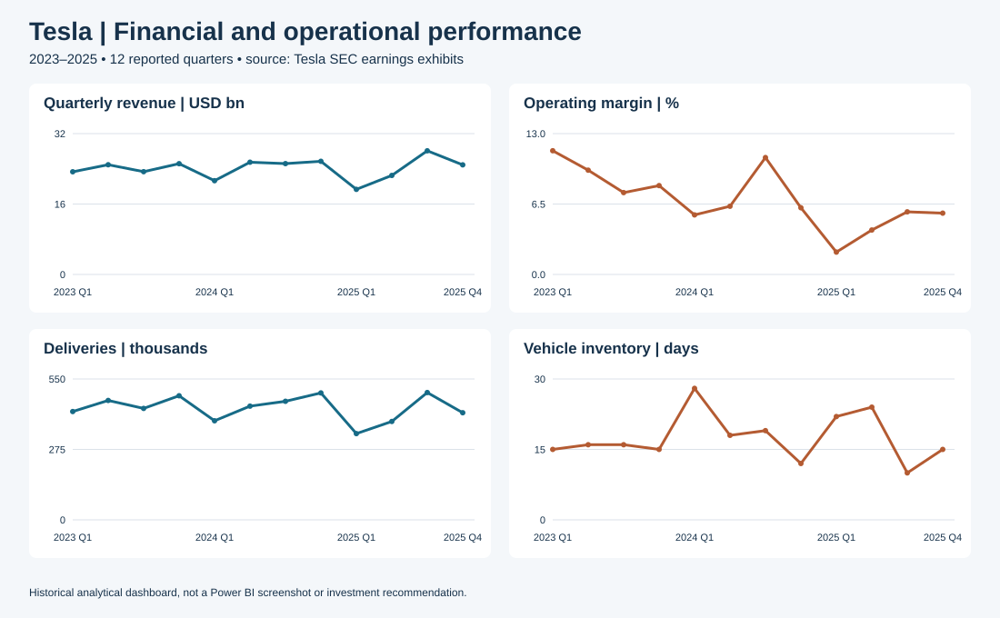

# Tesla quarterly performance analytics | 2023–2025

Independent analysis of 12 quarters of actual company-reported data, transcribed from Tesla's SEC earnings exhibits. USD millions, unit counts and days of supply. This is a fixed historical snapshot, not the latest quarter.
Sources:
- Q1 2024 update (2023 quarters): https://www.sec.gov/Archives/edgar/data/1318605/000095017024046895/tsla-ex99_1.htm
- Q4 2024 update: https://www.sec.gov/Archives/edgar/data/1318605/000162828025002993/exhibit991.htm
- Q4 2025 update: https://www.sec.gov/Archives/edgar/data/1318605/000162828026003837/exhibit991.htm
- Investor relations: https://ir.tesla.com/
Run: pip install pandas matplotlib; python analytics_v2/run.py. SQL uses CTEs, LAG and window calculations. See findings.md and power_bi.md. The SVG and findings are calculated from bundled data; Python and SQL runtime validation passed in [GitHub Actions](https://github.com/Krgaurav93084/Tesla-Business-KPI-Analysis/actions/runs/45620622068). DAX still requires Power BI Desktop verification. Forecast baseline is prior-year quarterly deliveries, evaluated on 2025; not company guidance. Regional quarterly results not provided in these summary tables, so no fabricated regional series. Original academic analysis retained.

The [generated dashboard PNG and KPI tables](https://github.com/Krgaurav93084/Tesla-Business-KPI-Analysis/actions/runs/45620622068/artifacts/15023857964) are available from the successful workflow (artifact retention applies). No native PBIX or Power BI Desktop screenshot is claimed.
